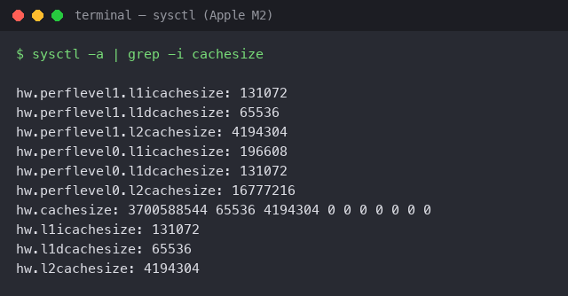
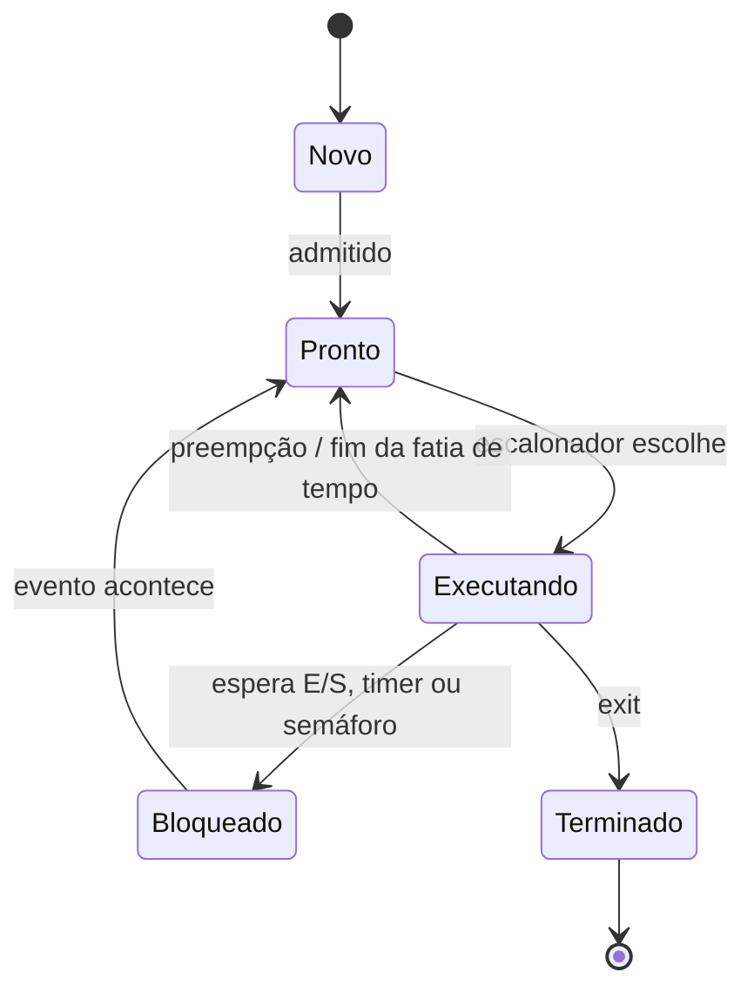
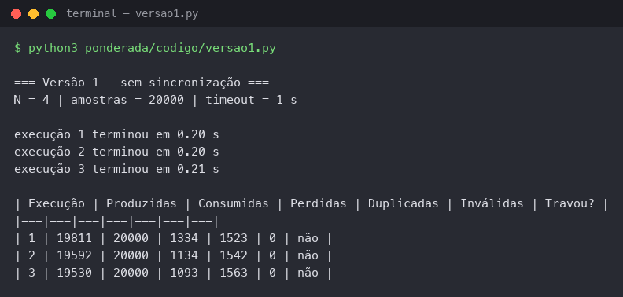
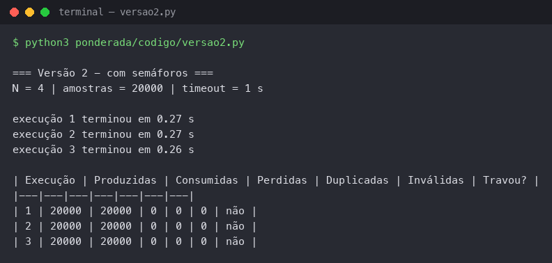
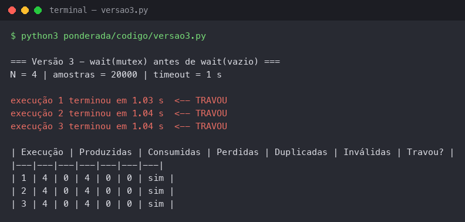
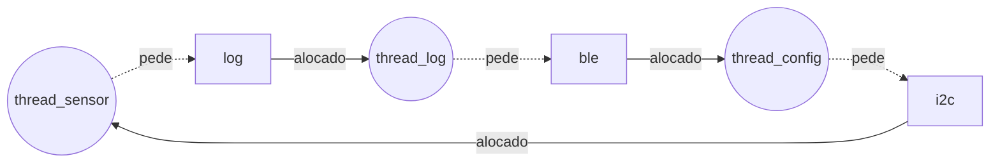

**Pedro Jorge Alves Soares | D1 = 5 | D2 = 1 | N = 4**

# Ponderada CC08: do pipeline ao deadlock (Tato)

## Parâmetros individuais

| Item | Conta | Valor |
|---|---|---|
| D1 | "Pedro" tem 5 letras | **5** |
| Total de letras | Pedro (5) + Jorge (5) + Alves (5) + Soares (6) | 21 |
| D2 | último dígito de 21 | **1** |
| IC (instruções por amostra) | 100.000 + 20.000 × 1 | **120.000** |
| m (falta na L1 da Plataforma V) | 3% + 0,5% × 5 | **5,5% = 0,055** |
| N (tamanho do buffer) | 3 + (1 mod 5) = 3 + 1 | **4** |

---

# Parte A: o problema técnico

## A1. Arquitetura e memória: qual processador vai na pulseira?

### Plataforma H (Harvard, 48 MHz, sem SO)

```
Ciclos por amostra = IC × CPI = 120.000 × 1,5 = 180.000 ciclos
Período do clock   = 1 / 48 MHz = 20,83 ns
Tempo por amostra  = 180.000 / 48.000.000 Hz = 0,00375 s = 3,75 ms
```

**3,75 ms ≤ 5 ms: atende**, com folga de 1,25 ms (25% do limite).

### Plataforma V (Von Neumann, 1,2 GHz, Linux)

Tempo médio de acesso à memória:

```
AMAT = tempo de acerto + m × penalidade
     = 1 + 0,055 × 120
     = 1 + 6,6 = 7,6 ciclos
```

CPI efetivo:

```
CPI_ef = 1,0 + (acessos por instrução × m × penalidade)
       = 1,0 + 1,3 × 0,055 × 120
       = 1,0 + 8,58 = 9,58
```

Tempo por amostra e pior caso:

```
Ciclos por amostra = 120.000 × 9,58 = 1.149.600 ciclos
Tempo médio        = 1.149.600 / 1.200.000.000 Hz = 0,958 ms
Pior caso          = 0,958 ms + 3 ms (atraso do Linux) = 3,958 ms
```

**3,958 ms ≤ 5 ms: atende**, com folga de 1,042 ms (21%). Dois detalhes:

- As faltas na cache fazem a CPU de 1,2 GHz rodar como se tivesse CPI 9,58. Ela fica parada 89,6% do tempo (8,58 de 9,58 ciclos) esperando a DRAM.
- A margem depende de dois números que não controlamos bem. Cada ponto percentual a mais em m soma 1,3 × 0,01 × 120 = 1,56 de CPI, ou seja, +0,156 ms. E o "até 3 ms" do Linux é uma estimativa, não uma garantia: basta o SO atrasar mais de 4,04 ms para estourar.

### Acelerador DSP na Plataforma H (Lei de Amdahl)

Fração acelerada f = 0,6; aceleração da parte s = 5.

```
Speedup = 1 / ((1 − f) + f / s)
        = 1 / (0,4 + 0,6 / 5)
        = 1 / (0,4 + 0,12)
        = 1 / 0,52 ≈ 1,92

Novo tempo = 3,75 ms / 1,923 = 3,75 × 0,52 = 1,95 ms
```

**1,95 ms ≤ 5 ms: atende**, agora com folga de 3,05 ms (61%). A Plataforma H já atendia sem o DSP. O que o DSP compra é margem. Mesmo com um DSP infinitamente rápido, o speedup não passaria de 1 / 0,4 = 2,5: os 40% que não são filtro passam a mandar no tempo.

### Resumo da A1

| Plataforma | Tempo por amostra | Pior caso | Atende 5 ms? | Folga |
|---|---|---|---|---|
| H | 3,75 ms | 3,75 ms (determinístico) | Sim | 1,25 ms |
| H + DSP | 1,95 ms | 1,95 ms (determinístico) | Sim | 3,05 ms |
| V | 0,958 ms | 3,958 ms | Sim | 1,042 ms |

### Por que a V precisa de cache e a H não?

Na arquitetura de Von Neumann, instruções e dados passam pelo mesmo barramento até a mesma memória. Na V essa memória é uma DRAM externa a 120 ciclos de distância, e cada instrução faz 1,3 acessos. Sem cache, isso daria CPI ≈ 1 + 1,3 × 120 = 157: esse é o gargalo de Von Neumann. Na H, a arquitetura Harvard tem barramentos separados para instrução e dado, e a SRAM interna responde em 1 ciclo. A memória já acompanha a CPU, então não há gargalo para a cache esconder.

### Evidência da minha máquina



O print (`sysctl -a | grep -i cachesize`, num Apple M2) mostra a L1 dividida em duas: **L1i** (instruções) e **L1d** (dados). Nos núcleos de desempenho (`perflevel0`) são 192 KB de L1i e 128 KB de L1d; nos núcleos de eficiência (`perflevel1`), 128 KB e 64 KB. A L2 é unificada (16 MB no cluster de desempenho, 4 MB no de eficiência), e a memória principal também: não há L3 neste chip.

Meu computador é uma **Harvard modificada**. Do ponto de vista do programador ele é **Von Neumann**: existe uma única memória principal, e instruções e dados ficam no mesmo espaço de endereçamento (é por isso que um programa pode carregar outro programa como dado e depois executá-lo). Só no nível mais próximo do núcleo a L1 é separada, como numa Harvard. Assim a busca de instrução e o acesso a dado acontecem no mesmo ciclo sem disputar a mesma cache. Essa separação é a mesma ideia da Plataforma H, usada para atenuar o gargalo de Von Neumann da Plataforma V.

---

## A2. Pipeline: o loop do filtro

```
1  lw   x5, 0(x10)     # lê a amostra nova
2  add  x6, x6, x5     # soma += nova
3  lw   x7, 0(x11)     # lê a amostra mais antiga
4  sub  x6, x6, x7     # soma -= antiga
5  sw   x6, 0(x12)     # grava a soma
6  addi x10, x10, 4    # avança o ponteiro da nova
7  addi x11, x11, 4    # avança o ponteiro da antiga
```

### Dependências RAW

| Consumidora | Produtora | Registrador | Tipo |
|---|---|---|---|
| 2 (add) | 1 (lw) | x5 | load-uso |
| 4 (sub) | 2 (add) | x6 | ULA → ULA |
| 4 (sub) | 3 (lw) | x7 | load-uso |
| 5 (sw) | 4 (sub) | x6 | ULA → store |

As instruções 6 e 7 escrevem em x10 e x11, que 1 e 3 leem. Isso é WAR (anti-dependência), não RAW, e não gera bolha no pipeline em ordem. Só restringe a reordenação: 6 tem que vir depois de 1, e 7 depois de 3.

### Sem forwarding

Como o banco de registradores é escrito na 1ª metade do ciclo e lido na 2ª, a consumidora pode fazer ID no mesmo ciclo do WB da produtora. Para instruções vizinhas, isso custa **2 bolhas** por dependência. Em cada linha, "st" marca uma bolha: a instrução fica parada esperando o operando.

| Instr. | 1 | 2 | 3 | 4 | 5 | 6 | 7 | 8 | 9 | 10 | 11 | 12 | 13 | 14 | 15 | 16 | 17 |
|---|---|---|---|---|---|---|---|---|---|---|---|---|---|---|---|---|---|
| 1 lw x5 | IF | ID | EX | MEM | WB | | | | | | | | | | | | |
| 2 add x6 | | IF | st | st | ID | EX | MEM | WB | | | | | | | | | |
| 3 lw x7 | | | | | IF | ID | EX | MEM | WB | | | | | | | | |
| 4 sub x6 | | | | | | IF | st | st | ID | EX | MEM | WB | | | | | |
| 5 sw x6 | | | | | | | | | IF | st | st | ID | EX | MEM | WB | | |
| 6 addi x10 | | | | | | | | | | | | IF | ID | EX | MEM | WB | |
| 7 addi x11 | | | | | | | | | | | | | IF | ID | EX | MEM | WB |

- 2 espera x5: o WB de 1 é no ciclo 5, então o ID de 2 vai para o ciclo 5 (2 bolhas).
- 4 espera x7: o WB de 3 é no ciclo 9, então o ID de 4 vai para o ciclo 9 (2 bolhas). O x6 de 2, com WB no ciclo 8, já está pronto.
- 5 espera x6: o WB de 4 é no ciclo 12, então o ID de 5 vai para o ciclo 12 (2 bolhas).

```
Total = (estágios + instruções − 1) + bolhas = (5 + 7 − 1) + 6 = 17 ciclos
```

### Com forwarding

Dependências de ULA para ULA são resolvidas pelo atalho EX/MEM → EX, sem bolha. Para o `lw`, o dado só existe no fim do estágio MEM, então ainda sobra **1 bolha** (atalho MEM/WB → EX).

| Instr. | 1 | 2 | 3 | 4 | 5 | 6 | 7 | 8 | 9 | 10 | 11 | 12 | 13 |
|---|---|---|---|---|---|---|---|---|---|---|---|---|---|
| 1 lw x5 | IF | ID | EX | MEM | WB | | | | | | | | |
| 2 add x6 | | IF | ID | st | EX | MEM | WB | | | | | | |
| 3 lw x7 | | | IF | st | ID | EX | MEM | WB | | | | | |
| 4 sub x6 | | | | | IF | ID | st | EX | MEM | WB | | | |
| 5 sw x6 | | | | | | IF | st | ID | EX | MEM | WB | | |
| 6 addi x10 | | | | | | | | IF | ID | EX | MEM | WB | |
| 7 addi x11 | | | | | | | | | IF | ID | EX | MEM | WB |

- 1 → 2 (x5): o MEM de 1 é no ciclo 4, o EX de 2 vai para o ciclo 5 (1 bolha, atalho MEM/WB → EX).
- 3 → 4 (x7): o MEM de 3 é no ciclo 7, o EX de 4 vai para o ciclo 8 (1 bolha).
- 2 → 4 (x6) e 4 → 5 (x6): resolvidos pelos atalhos, sem bolha.

```
Total = (5 + 7 − 1) + 2 = 13 ciclos
```

**O que continua causando bolha:** as dependências **load-uso**, 1 → 2 (x5) e 3 → 4 (x7). O `lw` só tem o dado no **fim** do estágio MEM, mas a instrução seguinte precisa dele no **começo** do EX, que acontece no mesmo ciclo. O forwarding transporta um valor que já existe. Ele não consegue entregar um valor que só vai ficar pronto no fim do ciclo em que já é necessário, então uma bolha é inevitável.

### Reordenação sem bolhas

Basta subir o segundo `lw` para logo depois do primeiro. Isso afasta cada load do seu uso:

```
1  lw   x5, 0(x10)
3  lw   x7, 0(x11)
2  add  x6, x6, x5     # x5 chega por MEM/WB -> EX (load 2 instruções antes)
4  sub  x6, x6, x7     # x7 por MEM/WB -> EX; x6 por EX/MEM -> EX
5  sw   x6, 0(x12)     # x6 por EX/MEM -> EX
6  addi x10, x10, 4
7  addi x11, x11, 4
```

O resultado não muda: 3 só depende de x11, que nenhuma instrução anterior altera. As restrições WAR continuam respeitadas, porque 6 vem depois de 1 e 7 vem depois de 3.

| Instr. | 1 | 2 | 3 | 4 | 5 | 6 | 7 | 8 | 9 | 10 | 11 |
|---|---|---|---|---|---|---|---|---|---|---|---|
| lw x5 | IF | ID | EX | MEM | WB | | | | | | |
| lw x7 | | IF | ID | EX | MEM | WB | | | | | |
| add x6 | | | IF | ID | EX | MEM | WB | | | | |
| sub x6 | | | | IF | ID | EX | MEM | WB | | | |
| sw x6 | | | | | IF | ID | EX | MEM | WB | | |
| addi x10 | | | | | | IF | ID | EX | MEM | WB | |
| addi x11 | | | | | | | IF | ID | EX | MEM | WB |

```
Total = 5 + 7 − 1 = 11 ciclos (mínimo possível, zero bolhas)
```

Resumo: 17 → 13 → 11 ciclos (sem forwarding → com forwarding → com forwarding e reordenado).

---

## A3. Processos e threads: como organizar o software

### Organização proposta (Plataforma V)

```
┌──────────── Processo "tato-core" (prioridade tempo real) ──────────────┐
│  thread_sensor ──► buffer (A4) ──► thread_processa ──► thread_motor    │
│                         │                                              │
│                         └──► fila de log (não bloqueante)              │
└─────────────────────────────────┬──────────────────────────────────────┘
                                  │ IPC (socket Unix / fila de mensagens)
┌─────────────────────────────────┴──────────────────────────────────────┐
│  Processo "tato-ble" (usuário sem privilégio, sandbox)                 │
│    envia o log para o celular, recebe comandos de configuração         │
└────────────────────────────────────────────────────────────────────────┘
```

- **Sensor, processamento e motor viram threads do mesmo processo.**
  - *Memória compartilhada:* as três passam uma amostra adiante a cada 10 ms. Como threads, usam o mesmo buffer (o da A4) direto na memória, sem cópia e sem chamada ao sistema.
  - *Criação e troca de contexto:* trocar entre threads do mesmo processo não troca espaço de endereçamento nem esvazia a TLB. Isso importa num caminho que precisa fechar em 5 ms e que, na V, já gasta até 3,958 ms no pior caso.
  - *Isolamento:* não é perda real. Se qualquer uma das três falhar, a pulseira já deixou de cumprir a função dela, então isolar uma da outra não salva nada.
- **BLE vira processo separado.**
  - *Memória compartilhada:* o BLE não está no caminho crítico. Ele só recebe o log e devolve comandos raros, e uma mensagem por IPC basta. Se a fila encher, o core descarta log; nunca espera.
  - *Criação e troca de contexto:* o processo é criado uma vez, no boot. A troca de contexto mais cara só acontece quando há log para enviar, fora da janela dos 5 ms.
  - *Isolamento:* é o módulo mais complexo e o único exposto ao mundo exterior. Se ele travar ou cair, o core continua vibrando e um supervisor (systemd) reinicia só o BLE.

### Falha explorada no BLE: thread ou processo?

- **BLE como thread:** o atacante herda o espaço de endereçamento inteiro do core. Pode sobrescrever o buffer de amostras, mudar os limiares de distância, desligar o motor ou ler tudo na memória, com todos os privilégios do core (que costuma rodar como root para acessar GPIO e I2C). Na prática, ele controla o que a pessoa sente, ou seja, se ela é avisada do poste ou não.
- **BLE como processo:** a MMU impede que ele leia ou escreva a memória do core. O atacante fica preso num processo sem privilégios, que só fala com o core por mensagens. O core valida cada comando (tipo, faixa de valores, origem) e pode recusar o que for estranho. O pior caso cai de "controle total da pulseira" para "mandar comandos que o core recusa" ou "derrubar o BLE".

### Diagrama de estados



**A thread do sensor passa a maior parte do tempo em Bloqueado.** Ela acorda a cada 10 ms (timer) e faz uma leitura I2C, que leva dezenas de microssegundos e na qual ela também fica bloqueada esperando a interrupção do barramento. Depois entrega a amostra ao buffer e volta a dormir até o próximo período. O processamento pesado, 0,958 ms em média na V, é da `thread_processa`. O sensor ocupa a CPU bem menos de 10% do período, então fica mais de 90% do tempo bloqueado. Ele quase nunca fica em Pronto: com prioridade de tempo real, quando acorda, o escalonador o coloca para executar praticamente na hora.

---

## A4. Código com semáforos: o buffer entre o sensor e o motor

Código em [`codigo/`](codigo/), em Python 3 com `threading`, buffer de **N = 4** posições e 20.000 amostras. Cada script roda 3 execuções e imprime a tabela. O consumidor considera **travamento** ficar 1 s sem receber nada.

Como as colunas foram calculadas:
- **Consumidas:** leituras feitas pelo consumidor.
- **Perdidas:** amostras produzidas que nunca chegaram ao consumidor, seja porque foram sobrescritas, seja porque ficaram presas no buffer.
- **Duplicadas:** leituras repetidas de uma amostra já recebida.

### Resultados

Execuções feitas num Apple M2 (macOS), Python 3:

| Versão | Execução | Produzidas | Consumidas | Perdidas | Duplicadas | Travou? |
|---|---|---|---|---|---|---|
| 1 (sem sincronização) | 1 | 19.811 | 20.000 | 1.334 | 1.523 | não |
| 1 (sem sincronização) | 2 | 19.592 | 20.000 | 1.134 | 1.542 | não |
| 1 (sem sincronização) | 3 | 19.530 | 20.000 | 1.093 | 1.563 | não |
| 2 (semáforos) | 1 | 20.000 | 20.000 | 0 | 0 | não |
| 2 (semáforos) | 2 | 20.000 | 20.000 | 0 | 0 | não |
| 2 (semáforos) | 3 | 20.000 | 20.000 | 0 | 0 | não |
| 3 (ordem trocada) | 1 | 4 | 0 | 4 | 0 | **sim** |
| 3 (ordem trocada) | 2 | 4 | 0 | 4 | 0 | **sim** |
| 3 (ordem trocada) | 3 | 4 | 0 | 4 | 0 | **sim** |

Na versão 1, o produtor parou antes das 20.000 (19.811, 19.592 e 19.530) porque o consumidor já tinha feito as 20.000 leituras (parte delas repetidas) e mandou encerrar.

### Prints







### Região crítica da versão 1 e por que ela perde ou duplica

A região crítica é a atualização do contador compartilhado de posições ocupadas, junto com a escrita ou leitura do buffer que ela acompanha:

```python
tmp = estado.contador    # lê
time.sleep(0)            # é interrompida aqui
estado.contador = tmp ± 1  # escreve um valor velho
```

O "ler, modificar, escrever" não é atômico. Se a outra thread mexe no contador entre a leitura e a escrita, uma das atualizações se perde (*lost update*). Exemplo com o contador em 2:

1. O produtor lê 2 e é interrompido.
2. O consumidor lê 2 e escreve 1.
3. O produtor volta e escreve 2 + 1 = 3.

O decremento do consumidor sumiu. O contador diz 3, mas só há 2 amostras novas no buffer. O consumidor então lê uma posição que já tinha lido: **duplicada**.

No caso inverso, o incremento do produtor é que some. O contador fica menor do que o real, o produtor acha que tem espaço e escreve por cima de uma amostra ainda não lida: **perdida**. Por isso perdidas e duplicadas aparecem na mesma ordem de grandeza (1.334 e 1.523 na execução 1, por exemplo): o contador vai errando para os dois lados.

O **travamento** também pode acontecer: se o produtor termina as 20.000 amostras num momento em que o contador corrompido marca 0 com amostras ainda presas no buffer, o consumidor fica esperando algo que, pelo contador, não existe, e encerra depois de 1 s. Nas três execuções acima o consumidor completou as leituras antes disso, mas o resultado depende da sorte do escalonador: é exatamente o tipo de bug que aparece "de vez em quando" em campo. Em todos os casos, a pulseira vibraria por obstáculos velhos e deixaria de vibrar por obstáculos novos.

### O que cada semáforo garante na versão 2

- **vazio (começa em N = 4):** conta as posições livres. O produtor faz wait(vazio) antes de escrever, então nunca há mais de 4 amostras não lidas e **nenhuma amostra é sobrescrita**: zero perdidas. Com o buffer cheio, o produtor dorme em vez de girar em espera ocupada.
- **cheio (começa em 0):** conta as posições ocupadas. O consumidor faz wait(cheio) antes de ler, então só lê uma posição já escrita e ainda não consumida: **zero duplicadas e zero lixo**. Com o buffer vazio, o consumidor dorme.
- **mutex (começa em 1):** dá **exclusão mútua** no acesso ao buffer e aos índices `entrada` e `saida`. Com um só produtor e um só consumidor, cada um mexe no próprio índice, então vazio e cheio já bastariam. O mutex é o que mantém o código correto se surgir um segundo produtor ou consumidor, por exemplo uma thread de log lendo o mesmo buffer.

O `time.sleep(0)` continua dentro da região crítica, no mesmo lugar da versão 1, e as três execuções deram 20.000 consumidas, 0 perdidas e 0 duplicadas. A interrupção no pior momento deixou de causar estrago, porque nenhuma outra thread entra enquanto a região está ocupada.

### O que aconteceu na versão 3

As três execuções **travaram** com 4 amostras produzidas e 0 consumidas. O produtor começa primeiro e enche as N = 4 posições, levando vazio a 0. Na 5ª amostra:

1. O produtor faz wait(mutex) e **consegue**: mutex vai a 0.
2. O produtor faz wait(vazio) e **dorme**, porque o buffer está cheio. Mas dorme **segurando o mutex**.
3. O consumidor faz wait(cheio) e consegue, porque cheio vale 4.
4. O consumidor faz wait(mutex) e **dorme**, porque o mutex está com o produtor.

O produtor só acorda quando o consumidor der signal(vazio), e o consumidor só chega lá depois de conseguir o mutex que o produtor segura. É um **deadlock**: espera circular entre dois recursos (mutex e vazio), com as mesmas quatro condições da A5.

A regra que a versão 2 respeita é: primeiro espere pela condição (vazio ou cheio), só depois pegue o mutex. Nunca durma em um semáforo de contagem segurando o mutex. Com N = 4 pequeno, o buffer enche quase na hora, então o deadlock acontece já na 5ª amostra. Na pulseira, isso é o motor parado e a pessoa sem aviso.

---

## A5. Deadlock: a pulseira congelou

### Sequência que leva ao deadlock

| Passo | Thread | Operação | Resultado |
|---|---|---|---|
| 1 | thread_sensor | P(i2c) | consegue; segura i2c |
| 2 | thread_log | P(log) | consegue; segura log |
| 3 | thread_config | P(ble) | consegue; segura ble |
| 4 | thread_sensor | le_sensor(); P(log) | **bloqueia**: log está com thread_log |
| 5 | thread_log | le_log(); P(ble) | **bloqueia**: ble está com thread_config |
| 6 | thread_config | recebe_comando(); P(i2c) | **bloqueia**: i2c está com thread_sensor |

Depois do passo 6, ninguém pode dar V, porque os três V estão depois dos P que travaram. A pulseira para até alguém reiniciar.

### Grafo de alocação de recursos nesse instante

Seta recurso → thread significa "alocado a". Seta thread → recurso significa "pedindo".



O ciclo é sensor → log → thread_log → ble → thread_config → i2c → sensor. Cada recurso tem uma única instância, então um ciclo no grafo **é** deadlock.

### As quatro condições no código

1. **Exclusão mútua:** i2c, log e ble são protegidos por semáforos binários (iniciados em 1). Só uma thread usa cada recurso por vez.
2. **Posse e espera (hold and wait):** cada thread faz o segundo P **sem soltar** o primeiro recurso. O sensor segura i2c e pede log; o log segura log e pede ble; o config segura ble e pede i2c.
3. **Não preempção:** um semáforo não é tirado de quem o segura. Só a própria thread libera, com V, e ela está bloqueada antes do V.
4. **Espera circular:** a ordem de aquisição forma um ciclo (i2c → log → ble → i2c). Cada thread pega os recursos numa ordem diferente das outras.

### Correção 1 (prevenção): nunca segurar dois recursos ao mesmo tempo

Nenhuma das três threads precisa realmente de dois recursos juntos. Elas usam um, terminam, e depois usam o outro. Quebrando a posse e espera, a espera circular também desaparece:

```
thread_sensor:          thread_log:              thread_config:
  P(i2c)                  P(log)                   P(ble)
  le_sensor()             le_log()   # copia       recebe_comando()  # copia
  V(i2c)                  V(log)                   V(ble)
  P(log)                  P(ble)                   P(i2c)
  registra()              envia()                  ajusta_sensor()
  V(log)                  V(ble)                   V(i2c)
```

Fica também a regra para código futuro: se alguma thread precisar de dois recursos ao mesmo tempo, adquire sempre na ordem global **i2c → log → ble**.

Só impor a ordem global, sem soltar os recursos, seria pior aqui. A thread_config teria que fazer P(i2c) antes de P(ble) e ficaria segurando o barramento do sensor enquanto espera um comando do celular, que pode levar segundos. O sensor ficaria sem ler e o limite de 5 ms estouraria.

**Para quem usa:** o congelamento deixa de existir. Além disso, o sensor solta o I2C antes de gravar o log, então a leitura fica mais rápida. O custo é interno: o log e o comando são copiados para um buffer local antes de soltar o semáforo, alguns bytes a mais de RAM.

### Correção 2 (detecção e recuperação): watchdog

Cada thread incrementa um contador de "batimento" a cada ciclo. Uma thread monitora, de prioridade máxima e sem pegar nenhum dos três semáforos, verifica a cada 20 ms se o batimento da thread_sensor avançou. Se ficou parado por 100 ms (10 amostras perdidas), ela declara deadlock e recupera. Como reserva, há o watchdog de hardware: se nem a monitora rodar, o chip reinicia sozinho.

- **Recuperação leve:** reinicia as threads envolvidas e os semáforos, preservando a configuração.
- **Recuperação pesada:** reinicia a pulseira inteira (é a opção do Dilema 1).

**Para quem usa:** o bug continua lá, cerca de uma vez a cada 10.000 horas, mas a pulseira volta sozinha em vez de exigir desligar e ligar. A pessoa fica alguns décimos de segundo sem vibração na recuperação leve, ou cerca de 4 s na reinicialização completa. Deve ser avisada por um pulso longo, para saber que naquele intervalo não está protegida. É mais rápido de implementar, mas não remove a causa: só encurta o estrago.

---

# Parte B: a decisão do CTO

## Dilema 2: qual processador vai para a produção?

**Para:** Conselho da Tato
**De:** Pedro Jorge Alves Soares, CTO
**Assunto:** Plataforma de produção

**Decisão: vamos produzir com a Plataforma H com o acelerador DSP (R$ 37 por unidade).**

**Por quê.** A pulseira avisa uma pessoa cega de um poste. Para isso, o que importa é o pior caso, não a média. Na A1, a Plataforma V faz em média 0,958 ms por amostra, mas no pior caso chega a **3,958 ms** e fica a 1,04 ms do limite de 5 ms. Essa margem depende de dois números que não controlamos: a taxa de falta de 5,5% (cada ponto a mais custa +0,156 ms) e o "até 3 ms" de atraso do Linux, que é estimativa, não garantia. A H com DSP leva **1,95 ms**, sempre, sem SO e sem cache: 61% de folga, que podemos gastar em novas funções do filtro. A H sem DSP (3,75 ms) também atende, mas com 25% de folga. Os R$ 15 do DSP compram espaço para o produto crescer sem trocar de chip.

**Do que estou abrindo mão.** Da atualização pela internet. Na H, cada correção de firmware exige cabo, na assistência técnica.
- **Quem paga primeiro é o usuário:** deslocar-se até a assistência é mais difícil para uma pessoa com deficiência visual, e ela fica sem a pulseira durante o atendimento.
- **Depois paga a empresa:** a logística de recall.

Como mitigação, proponho troca pelos Correios com pulseira reserva: o usuário recebe a nova antes de devolver a antiga. Abro mão também de rodar bibliotecas prontas de Linux, o que torna mais lento desenvolver funções novas.

**Quanto economizamos.** Para as primeiras 2.000 unidades: 2.000 × (R$ 70 − R$ 37) = **R$ 66 mil**. Esse dinheiro deve ir para o programa de troca e para testes antes de cada lote, porque errar no firmware fica mais caro sem OTA.

**Impacto e segurança.** Para o usuário, a vibração tem tempo de resposta fixo e previsível, e um microcontrolador de 48 MHz tende a gastar menos bateria que um SoC de 1,2 GHz. Sem Linux, a superfície de ataque cai para um único ponto, o tratamento das mensagens BLE. O risco que aceito é o oposto: se aparecer uma falha nesse ponto, não consigo corrigi-la remotamente. Por isso o BLE terá protocolo mínimo (formato fixo, faixas validadas), configuração remota desligável e firmware assinado para impedir gravação de código falso pelo cabo.

**O que me faria mudar de ideia.** Se um protótipo da Plataforma V com kernel de tempo real (PREEMPT_RT) rodar **30 dias seguidos, cerca de 259 milhões de amostras, sem nenhuma acima de 5 ms**, e o custo médio de uma correção por cabo passar de **R$ 33 por pulseira** (a diferença de preço entre V e H + DSP), migro para a V no segundo lote.
